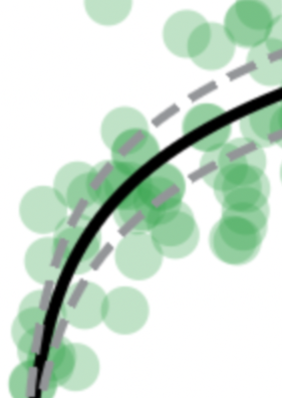
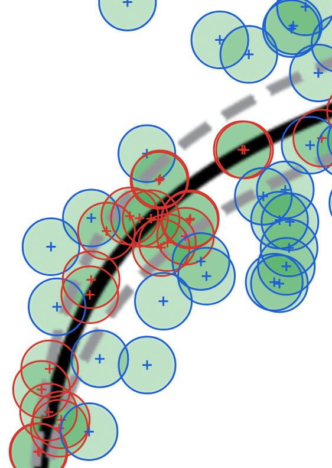

# dotscraper

Finds the dots in an image of a scatterplot or dot plot and reports where they are, in pixels and, once the axes have
values, in data units. It is made for the hard case: dots that overlap, drawn with transparency, where counting blobs
or circles fails.

**Try it:** https://xangregg.github.io/dotscraper/ (everything runs in your browser; images are never uploaded)

<p align="center">
  
  &nbsp;
  
</p>

Part of a scatterplot (a synthetic one, drawn to resemble a published figure), and the same part with the dots
dotscraper finds: blue for a dot it is sure of, red for one it flags as doubtful (mostly hidden, deep in a stack, or
weakly supported).

## How it works

Analysis by synthesis. dotscraper measures the dots' style (color, size, transparency, edge blur, outline), sets aside
what isn't dots (text, lines, axes, shaded bands), and then searches for the set of dot positions whose rendering
reproduces the image. A dot hidden in a stack of translucent dots shows up as a darker level, not as an edge, so
stacks can be counted. Each dot gets a position, a standard error and flags for anything doubtful; ticks on the axes
turn positions into data values.

## Using it

1. Open an image (Open…, paste or drop). A PNG straight from the source works best; screenshots and JPEGs work with
   *Noisy color matching*.
2. Check the dot families it found, one per dot color. Add a missing one with *Add family by color*.
3. Find dots, then review: hover a dot for its numbers; flagged dots are red, possible duplicates have a magenta
   double ring, and the Residual view shows what the dots don't explain.
4. Fix with Add, Remove and Move (Option-click edits without refitting the dots nearby).
5. Check the tick values read from the labels, or type them where none were read, for data units; then Copy
   table or Save CSV.

The About panel in the app has the details, the keys, and what to trust.

## Limits

- Opaque dots hide one another: a dot entirely behind others can't be found, so a stack's count is a lower bound.
- The ± values come from pixel noise alone; the real error is a few tenths of a pixel.
- Round markers only. Triangles, squares and other shapes are future work.

## Development

Plain ES modules, no build step and no runtime dependencies. Node 22 or later for the tests and tools.
The code was largely written with [Claude Code](https://claude.com/claude-code), working from `PLAN.md` and
`CLAUDE.md`.

```bash
npm install
```

```bash
npm test
```

```bash
npm run serve
```

`npm run serve` serves the app at http://localhost:8003/. With the server running,
`npm run check:page -- http://localhost:8003/` loads the page headless and fails on any console error.

**Dev mode** adds what only development needs: the list of local test images (and the `#image=` URL that reopens
one), *Save truth* for placing ground truth by hand, and the diagnostic views (Count, Mask, Classes, Model; Image and
Residual are for everyone). It is on for a local server and off on the deployed site;
`?dev` turns it on anywhere and `?dev=0` off, to see the public view locally. A "dev" badge by the title shows it.

`npm run bench` scores the detector against ground truth: synthetic presets, and the renderings in `bench1/`–`bench3/`
with their exact data, R's renderings in `bench-r/` and `bench-r2/` (drawn by their `make.R` from random points),
and figures from PLOS ONE articles in `bench-plos/` and from other articles in PubMed Central
in `bench-pmc/`, which are CC BY 4.0 and credited in each folder's README. The other real-world test images
(`bench-local/`, `bench-nature/`) are third-party figures that are not cleared for redistribution, so they stay local
and out of the repository; the benchmark and the tests skip them when they're absent.

`npm run results` runs the whole benchmark and rewrites `RESULTS.md`: every image's counts, precision, recall and a
note. `PLAN.md` has the design, the decisions and every measurement; `CLAUDE.md` has the conventions.

## Deployment

GitHub Pages serves the repository as it is: Settings → Pages → *Deploy from a branch*, branch `main`, folder `/`
(root). There is nothing to build. The local test images are git-ignored, so the deployed site never has them; out of
dev mode the app doesn't look for them.

## License

BSD Zero Clause License (0BSD). See `LICENSE`.
